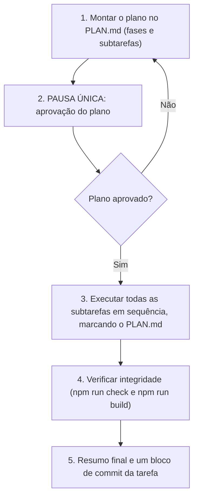

# Guia e Guardrails para Desenvolvimento com IA — PedMesa (frontend)

Regras inegociáveis, padrões e protocolo de trabalho obrigatório para qualquer agente de IA que atue neste repositório. A arquitetura, os requisitos e o andamento do projeto ficam em `docs/` (`ARQUITETURA.md`, `REQUISITOS.md` e `ANDAMENTO.md`) e devem ser lidos antes de propor mudanças.

> [!IMPORTANT]
> **A IA nunca executa escrita no Git e nunca começa a codar sem o plano aprovado.** O plano é aprovado uma única vez; depois disso, a IA executa todas as subtarefas em sequência e entrega um único bloco de commit no fim.

---

## 1. Princípio fundamental de operação

O agente atua em regime de **pair programming supervisionado**. O papel dele é acelerar a implementação mantendo precisão arquitetural, tipagem estrita e segurança.

- **Menor alteração possível:** altere estritamente o necessário para cumprir os critérios de aceite. Não refatore trechos não relacionados sem pedido.
- **Respeito a tipos e contratos:** os tipos em `src/types/` espelham o contrato da API (`snake_case`). Mudança de contrato nasce no backend.
- **Tratamento de erros:** não engula exceções. Erro de API vira mensagem para o usuário (`src/lib/api-error.ts` e `ToastContext`); nada de `catch` vazio.
- **Segurança:** nunca grave token, segredo ou URL de ambiente no código; use `import.meta.env.VITE_*` (lembrando que tudo o que é `VITE_*` vai para o bundle e é público). Siga a skill `secure-coding-guidelines` em qualquer tela que envie dados ao backend.

---

## 2. Protocolo de entrada de tarefas (Jira e contexto)

O rastreador é o Jira, projeto **PED**, no site `samuelramos.atlassian.net`. Ao receber uma demanda ou chave (ex.: `PED-106`):

1. **Consulta via MCP:** leia a issue para extrair título, descrição, critérios de aceite, tipo, épico pai e status. Sem card, pergunte qual é antes de implementar algo grande.
2. **Escopo estrito do card:** melhorias, refatorações ou bugs fora do escopo são **relatados e sugeridos como um novo card**, não implementados junto. Card ambíguo ou em conflito com o código: aponte e pergunte.
3. **Contexto complementar:** consulte `docs/` e, quando a tela depender de regra de negócio, o `docs/ARQUITETURA.md` do `pedmesa-backend`.
4. **Planejamento no `PLAN.md`:** copie `.agents/PLAN.md.example` para `.agents/PLAN.md` (local, ignorado pelo Git) e estruture fases e subtarefas antes de alterar código.
5. **Alinhamento:** apresente o entendimento da demanda, a lista exata de arquivos que serão criados ou editados e o comando da branch (seção 4).

---

## 3. Execução com aprovação única do plano



- As subtarefas do `PLAN.md` organizam e registram o trabalho; **não geram pausas nem commits**.
- Ao apresentar o plano, entregue junto o comando da branch (seção 4) e termine com a pergunta: _"Plano da tarefa [PED-ID] pronto. Posso executar?"_
- Depois da aprovação, só pare antes do fim se algo bloquear, se um critério de aceite não puder ser cumprido ou se o plano precisar mudar de escopo.
- No fim, apresente o resumo, os arquivos criados e alterados, o resultado da verificação e o bloco de commit único.

---

## 4. Git, branches e commits

### Somente comandos manuais

- A IA está **proibida** de executar comandos de escrita no Git (`git commit`, `git push`, `git checkout -b`, `git switch -c`, `git merge`, `git rebase`, `git reset`, `git tag`, `git stash` etc.). Comandos de leitura (`git log`, `git branch -a`, `git show`) são permitidos para a IA se orientar.
- Toda ação Git é entregue em um **bloco de código** para o desenvolvedor executar, contendo só `git add`, `git commit` e `git push` (e `git checkout -b` quando for criar a branch). Não inclua `git status` nem `git diff` nos blocos nem nos checklists.
- `pedmesa-frontend` e `pedmesa-backend` são repositórios separados. Tarefa que mexe nos dois gera um bloco com `git -C <repositório>` e um commit para cada um.

### Branches: uma por épico

- GitLab Flow (ver `docs/GITFLOW.md`): toda branch sai da `main` mais recente.
- A branch é do **épico**: `PED-<ID-do-épico>-<titulo-do-epico-em-slug>`, em minúsculas, com hífens e sem acentos. Ex.: `PED-82-delivery-frontend`. Todas as tarefas do épico são commitadas nela; confira com `git branch -a` se ela já existe antes de sugerir o `git checkout -b`.

### Commits: um por tarefa

```text
<tipo>(<escopo>): [PED-<ID>] <descrição no imperativo, em português>
```

- **Um commit por tarefa**, com a chave da **tarefa** logo depois dos dois-pontos. Ex.: `feat(delivery): [PED-106] adiciona busca de cep no cadastro do cliente`.
- **No máximo 100 caracteres** no total; acima disso o Commitlint rejeita. Tarefa sem card: omita o `[PED-<ID>]`.
- **Nada de `Co-Authored-By`** nem qualquer atribuição de IA na mensagem.
- Tipos: `feat`, `fix`, `refactor`, `chore`, `docs` e `test`. Escopo: a tela ou a funcionalidade (`delivery`, `kds`, `caixa`, `garcom`, `admin`, `auth`, `ui`...).

### O que não fazer

- Não criar templates de PR nem de Issue no GitHub. As tarefas ficam no Jira.
- `.agents/PLAN.md` nunca vai para commit; o versionado é o `PLAN.md.example`, em branco.

---

## 5. Tipagem estrita

- `tsconfig.app.json` roda com `"strict": true`. **`any` é proibido.**
- Respostas externas entram como `unknown` (ou como o tipo do provedor) e são convertidas para um tipo de domínio nosso antes de chegar às telas.
- Evite `as Tipo` para silenciar o compilador; prefira type guards (`value is T`) e `satisfies`.
- **Pegadinha:** `npx tsc --noEmit` não checa nada aqui, porque o `tsconfig.json` é _solution-style_ (`files: []` + `references`). Use sempre `npm run check` (que roda `tsc -p tsconfig.app.json` e `tsc -p tsconfig.node.json`) ou `npm run build`.

---

## 6. Idiomas do projeto

| Item                                                                 | Idioma                        |
| -------------------------------------------------------------------- | ----------------------------- |
| Comentários, commits, documentação, `PLAN.md` e conversa             | Português (Brasil)            |
| Nomes de branch                                                      | Português, sem acentos        |
| Nomes do domínio no código (`comanda`, `integrante`, `MapaMesas`)    | Português, como já é o padrão |
| Termos técnicos (`Context`, `Provider`, `service`, `use…` dos hooks) | Inglês                        |
| Rotas de tela (`/caixa/mapa-mesas`) e textos exibidos ao usuário     | Português (Brasil)            |

---

## 7. Documentação em dia

Quando a alteração mudar telas, rotas, variáveis de ambiente, papéis ou fluxos, atualize `README.md`, `docs/ARQUITETURA.md` e, se couber, `docs/REQUISITOS.md` e `docs/ANDAMENTO.md` na mesma entrega.

---

## 8. Guardrails de arquitetura do frontend (React 19, Vite e Tailwind 4)

Este repositório é **só a interface** do sistema (painéis de garçom, cozinha, caixa, admin e super-admin). Regra de negócio e cálculo definitivo ficam no `pedmesa-backend`. Detalhes em `docs/ARQUITETURA.md`.

1. **Organização:**
   - `pages/<papel>/` (`admin`, `caixa`, `cozinha`, `garcom`, `superadmin`): telas que orquestram dados e componentes. Componentes usados só por uma tela ficam em `pages/<papel>/components/`.
   - `components/ui/`: componentes genéricos (`Modal`, `CurrencyInput`...); `components/layout/`: casca da aplicação.
   - `services/`: chamadas HTTP, um arquivo por recurso (`comanda.service.ts`...).
   - `contexts/`: estado global (`AuthContext`, `TenantContext`, `ThemeContext`, `ToastContext`).
   - `types/`: tipos do contrato da API; `lib/`: funções puras (formatação, dinheiro, rotas por papel).
2. **Nunca fure o cliente HTTP da API:** chamadas ao nosso backend passam sempre pela instância `api` (`src/services/api.ts`), que injeta a autenticação e o tenant. Chamadas a terceiros (ViaCEP, mapas, pagamentos) **nunca** usam essa instância, para não vazar credenciais: cada integração tem um service próprio com `fetch` ou um `axios.create()` separado, sem credenciais, que converte a resposta para um tipo de domínio nosso. Nunca crie uma segunda instância com credenciais.
3. **Generalize em vez de duplicar:** antes de copiar um componente ou hook para uma tela nova, torne o existente genérico e use-o nos dois lugares, mantendo a tela original funcionando.
4. **O backend é a fonte da verdade para valores de negócio:** totais, descontos, taxa de entrega e troco vêm da API. A UI formata e exibe; nunca calcula um valor que depois envia como definitivo. Dinheiro em tela passa por `src/lib/money.ts` e `src/lib/format.ts`.
5. **Acesso por papel:** as rotas protegidas usam `ProtectedRoute` e `SuperAdminProtectedRoute`; a tela inicial de cada papel vem de `src/lib/role-routes.ts`. Esconder um botão não é controle de acesso: o backend valida de novo.
6. **Acessibilidade:** o Biome roda as regras de a11y do preset recomendado. Prefira elementos semânticos (`button`, `a`) a `div` clicável; quando uma exceção for necessária, use `biome-ignore` com a justificativa.
7. **Testes visuais:** use `data-testid` descritivos e separados por hífen (`botao-imprimir-preconta`, `opcao-visao-<papel>`), seguindo os que já existem no componente.
