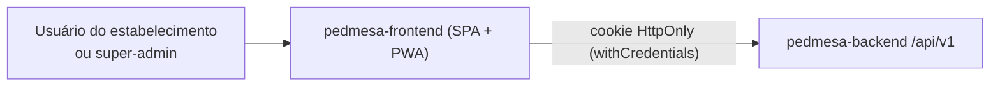

# Arquitetura — pedmesa-frontend

> Estado descrito: `main` mais o delivery do épico PED-82 (branch `PED-82-delivery-frontend`, ver `docs/ANDAMENTO.md`).

## 1. Stack

| Camada    | Tecnologia                                                   |
| --------- | ------------------------------------------------------------ |
| UI        | React 19, Tailwind CSS 4 (`@tailwindcss/vite`), lucide-react |
| Build     | Vite 8, TypeScript com `strict`                              |
| Rotas     | React Router 7                                               |
| HTTP      | Axios (instância única `api`, com `withCredentials`)         |
| Gráficos  | Recharts (dashboard)                                         |
| Qualidade | Biome, Husky e Commitlint                                    |

## 2. Visão de sistema



A regra de negócio e os valores definitivos (totais, descontos, taxa de entrega, troco) ficam no backend; a interface exibe e coleta dados.

## 3. Estrutura de pastas

```text
src/
  App.tsx              # rotas
  main.tsx             # providers e registro do service worker
  pages/
    Login, SelecionarVisao, NotFound, Unauthorized
    admin/             # DashboardProprietario, Produtos, Usuarios, ConfiguracoesEmpresa, TaxasEntrega
    caixa/             # MapaMesas, ComandaFechamento, PreContaImpressao
    caixa/delivery/    # NovoPedidoDelivery (etapas/ Cliente, Produtos, Pagamento) e seus hooks
    cozinha/           # Kds
    expedicao/         # Expedicao (Kanban), Clientes
    garcom/            # Mesas, ComandaDetalhe
    superadmin/        # PainelSuperAdmin, PainelLeads
    <papel>/components/  # componentes usados só pelas telas daquele papel
  components/ui/       # BarraEtapas, Button, Card, ConfirmDialog, CurrencyInput, ImageUpload, Input, Modal, OpcaoSelecionavel, Switch, ThemeToggle, Toast
  components/layout/   # AppShell, Sidebar
  components/<área>/   # compartilhados entre telas: carrinho, cardapio, delivery, endereco, kanban, pagamento
  components/          # ProtectedRoute, SuperAdminProtectedRoute, ImpersonationBanner
  hooks/               # useCarrinho, useEnderecoForm, useCepLookup, useConsultaPorChave, useComAtraso, usePolling
  services/            # api.ts, admin-api.ts, um service por recurso e cep.service (ViaCEP, sem credenciais)
  contexts/            # AuthContext, SuperAdminAuthContext, TenantContext, ThemeContext, ToastContext
  lib/                 # funções puras com testes: api-error, money, format, busca-cliente, novo-pedido-delivery, menu-delivery, role-routes...
  types/               # contrato da API em snake_case
```

## 4. Rotas e fluxo de navegação

| Rota                                                                                | Tela                  | Papel                            |
| ----------------------------------------------------------------------------------- | --------------------- | -------------------------------- |
| `/login`                                                                            | Login                 | público                          |
| `/selecionar-visao`                                                                 | Escolha de visão      | autenticado com mais de um papel |
| `/garcom/mesas`, `/garcom/comanda/:id`                                              | Mesas e comanda       | garcom                           |
| `/cozinha/kds`                                                                      | KDS                   | cozinha                          |
| `/caixa/mapa-mesas`, `/caixa/comanda/:id/fechamento`, `/caixa/comanda/:id/preconta` | Caixa                 | caixa                            |
| `/caixa/delivery/novo`                                                              | Novo pedido delivery  | expedicao, admin                 |
| `/expedicao`                                                                        | Kanban de expedição   | expedicao, admin                 |
| `/expedicao/clientes`                                                               | Clientes do delivery  | expedicao, admin                 |
| `/admin/dashboard`, `/admin/produtos`, `/admin/usuarios`, `/admin/configuracoes`    | Administração         | admin                            |
| `/admin/delivery/taxas`                                                             | Bairros e taxas       | admin                            |
| `/admin`, `/admin/leads`                                                            | Painel de super-admin | super-admin                      |
| `/nao-autorizado`, `*`                                                              | Erro de acesso e 404  | —                                |

Depois do login, `src/lib/role-routes.ts` decide a tela inicial pelo papel de maior prioridade; os nomes exibidos dos papéis ficam em `src/lib/role-labels.ts`.

O menu lateral (`Sidebar`) tem três seções: **Trocar visão** (as visões dos papéis do usuário), **Delivery** (Novo pedido, Expedição e Clientes, só para admin e expedição e só com `delivery_ativo`; regra em `src/lib/menu-delivery.ts`) e **Administração** (admin).

### Novo pedido delivery

Desde a 2ª rodada de ajustes: bairro não atendido mostra "Cadastrar o bairro X" para o admin (abre o `TaxaEntregaModal` compartilhado e refaz a cotação; PED-125); a etapa de pagamento tem desconto e isenção da taxa para quem tem `pode_conceder_desconto` (PED-126); no painel, "Entregues hoje" tem "Desfazer entrega", com motivo (PED-127).

Assistente em três etapas com a `BarraEtapas` no topo: **Cliente** (busca única por nome ou telefone, cadastro de cliente novo, endereço e frete), **Produtos** e **Pagamento** (forma, troco e revisão). As pendências de cada etapa e a liberação da seguinte ficam em `src/lib/novo-pedido-delivery.ts`; a classificação do termo da busca, em `src/lib/busca-cliente.ts`. Telefone completo cadastrado seleciona o cliente; não cadastrado abre o cadastro com o número. Tudo é operável pelo teclado (`Enter` avança o campo, `Ctrl+Enter` avança a etapa e envia na última).

## 5. Autenticação e acesso

- A sessão é um cookie HttpOnly gravado pela API no login (PED-76): o JavaScript não lê nem guarda o token. A instância `api` usa `withCredentials: true` para o navegador enviar o cookie.
- O `localStorage` guarda só os dados de exibição do usuário (`src/lib/auth-storage.ts` e `super-admin-auth-storage.ts`).
- Um interceptor de resposta trata o 401 (PED-77): limpa os dados do usuário, chama `POST /auth/logout` e redireciona para `/login`, ou para `/admin` quando um super-admin estava impersonando.
- `ProtectedRoute` exige login e papel; `SuperAdminProtectedRoute` protege o painel de super-admin, que tem sessão própria (`SuperAdminAuthContext`). Durante a impersonação, o `ImpersonationBanner` fica visível.
- Esconder um botão não é controle de acesso: o backend valida o papel de novo em toda rota.

## 6. Estado e dados

- Estado global por contexts (auth, tenant, tema e toasts); estado de tela com `useState`/`useEffect`.
- Erros de API viram mensagem amigável por `src/lib/api-error.ts` e são exibidos pelo `ToastContext`.
- Dinheiro em tela passa por `src/lib/money.ts` e `src/lib/format.ts`.
- Imagens (produtos e usuários) são enviadas pelo `ImageUpload` (arrastar e soltar, com prévia) para `POST /uploads`.

## 7. PWA

`public/manifest.webmanifest`, ícones e service worker (`public/sw.js`, registrado por `src/lib/register-service-worker.ts`). O nginx da imagem precisa servir o `.webmanifest` como `application/manifest+json`, senão a instalação não aparece.

## 8. Diretrizes arquiteturais

As regras completas (cliente HTTP único da API, integrações externas isoladas, generalizar em vez de duplicar, backend como fonte da verdade, acessibilidade) estão em `.agents/AGENTS.md`, seção 8.

### Guia visual (PED-132)

Tamanho, peso e cor saem dos tokens abaixo, não de uma classe escolhida na tela. Em desenvolvimento, a página `/dev/guia` mostra tudo no claro e no escuro (ela não entra no build).

**Tipografia** (`@theme` em `src/index.css`; cada token já traz entrelinha e peso)

| Classe               | Uso                                                              | Medida            |
| -------------------- | ---------------------------------------------------------------- | ----------------- |
| `text-titulo-pagina` | `h1` de cada tela (componente `TituloPagina`)                    | 24px · 1.25 · 600 |
| `text-titulo-secao`  | `h2` de seções, cards e modais                                   | 18px · 1.3 · 600  |
| `text-destaque`      | número do pedido ou da mesa, total (componente `NumeroDestaque`) | 36px · 1.1 · 600  |
| `text-corpo`         | texto padrão das telas                                           | 14px · 1.5 · 400  |
| `text-campo`         | valor digitado em input e select                                 | 16px · 1.5 · 400  |
| `text-legenda`       | horário, rótulo, selo, ajuda                                     | 12px · 1.4 · 400  |

- Só três pesos: 400 (texto), 500 (`font-medium`: rótulos, botões, selos) e 600 (`font-semibold`: títulos e números). Sem `font-bold` nem `font-extrabold`.
- Nada abaixo de 12px (sem `text-[10px]`, `text-[11px]`).
- Campos sempre em 16px: abaixo disso o Safari do iPhone dá zoom ao focar.
- Fonte do sistema (`system-ui`): carrega na hora e funciona offline no PWA.

**Paleta semântica** (`src/lib/tons.ts`): uma cor por significado.

| Tom         | Cor                         | Significa                                                                     |
| ----------- | --------------------------- | ----------------------------------------------------------------------------- |
| `marca`     | laranja (`--color-marca-*`) | ação principal, seleção, foco, item ativo do menu                             |
| `aviso`     | âmbar                       | aguardando ou pede atenção: pendente, observação do item, começando a atrasar |
| `andamento` | azul-céu                    | em preparo, em produção, em rota                                              |
| `sucesso`   | verde                       | pronto, pago, conectado, salvo                                                |
| `perigo`    | vermelho                    | erro, atrasado, cancelar e excluir                                            |
| `neutro`    | slate                       | concluído, cancelado (riscado), inativo, tipo de atendimento, todo o resto    |

- `CLASSES_DO_TOM[tom]` dá quatro variações: `selo` (suave, o padrão), `seloForte` (sólido, para ler de longe no KDS), `superficie` (bloco ou cabeçalho de coluna) e `texto`.
- Status nunca escolhem cor na tela: `TOM_STATUS_ITEM` (`lib/status-item.ts`) e `TOM_STATUS_ENTREGA` (`lib/expedicao.ts`) dizem o tom, e o teste `tons.test.ts` garante que todo status tem um. O mesmo momento tem o mesmo tom na cozinha e na expedição.
- A cor da marca usa o alias `marca-*` (`bg-marca-600`), não `orange-*`. Trocar a marca é mudar o `@theme`.
- Sem cor decorativa: violeta, azul ou amarelo "para destacar" não existem. Mesa e delivery se distinguem por ícone e texto (`TipoAtendimento`), não por cor.

**Componentes base** (`src/components/ui`): `Selo` (status com tom, opcional `forte` e `riscado`), `TipoAtendimento`, `NumeroDestaque`, `TituloPagina`, além de `Button`, `Card`, `Modal`, `Input`, `CurrencyInput`, `Switch`, `OpcaoSelecionavel`, `BarraEtapas`, `ConfirmDialog` e `Toast`, já nos tokens.

**Superfícies:** card com borda de 1px sutil e sombra leve (alpha abaixo de 0,08); no escuro, borda sem sombra. Sombra forte só em sobreposições (modal, toast).

A aplicação do guia no KDS é o PED-133, e nas demais telas, o PED-134.

## 9. Limitações conhecidas

- Os testes do Vitest cobrem só a lógica pura de `src/lib`; as telas não têm testes automatizados versionados, e o CI ainda não roda `npm test`.

## 10. Setup local e fluxo de trabalho

Setup e variáveis: `README.md`. Fluxo de branches: `docs/GITFLOW.md`. Pipelines: `docs/CICD.md`.
