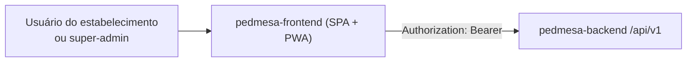

# Arquitetura — pedmesa-frontend

> Estado descrito: branch `main`. As telas do delivery estão na branch do épico PED-82 (ver `docs/ANDAMENTO.md`).

## 1. Stack

| Camada    | Tecnologia                                                   |
| --------- | ------------------------------------------------------------ |
| UI        | React 19, Tailwind CSS 4 (`@tailwindcss/vite`), lucide-react |
| Build     | Vite 8, TypeScript com `strict`                              |
| Rotas     | React Router 7                                               |
| HTTP      | Axios (instância única `api`)                                |
| Gráficos  | Recharts (dashboard)                                         |
| Qualidade | Biome, Husky e Commitlint                                    |

## 2. Visão de sistema



A regra de negócio e os valores definitivos (totais, descontos, troco) ficam no backend; a interface exibe e coleta dados.

## 3. Estrutura de pastas

```text
src/
  App.tsx              # rotas
  main.tsx             # providers e registro do service worker
  pages/
    Login, SelecionarVisao, NotFound, Unauthorized
    admin/             # DashboardProprietario, Produtos, Usuarios, ConfiguracoesEmpresa
    caixa/             # MapaMesas, ComandaFechamento, PreContaImpressao
    cozinha/           # Kds
    garcom/            # Mesas, ComandaDetalhe
    superadmin/        # PainelSuperAdmin, PainelLeads
    <papel>/components/  # componentes usados só pelas telas daquele papel
  components/ui/       # Button, Card, ConfirmDialog, CurrencyInput, Input, Modal, Switch, ThemeToggle, Toast
  components/layout/   # AppShell, Sidebar
  components/          # ProtectedRoute, SuperAdminProtectedRoute, ImpersonationBanner
  services/            # api.ts, admin-api.ts e um service por recurso
  contexts/            # AuthContext, SuperAdminAuthContext, TenantContext, ThemeContext, ToastContext
  lib/                 # api-error, auth-storage, money, format, desconto, role-routes...
  types/               # contrato da API em snake_case
```

## 4. Rotas e fluxo de navegação

| Rota                                                                                | Tela                  | Papel                            |
| ----------------------------------------------------------------------------------- | --------------------- | -------------------------------- |
| `/login`                                                                            | Login                 | público                          |
| `/selecionar-visao`                                                                 | Escolha de visão      | autenticado com mais de um papel |
| `/garcom/mesas`, `/garcom/comanda/:id`                                              | Mesas e comanda       | garcom                           |
| `/cozinha/kds`                                                                      | KDS                   | cozinha                          |
| `/caixa/mapa-mesas`, `/caixa/comanda/:id/fechamento`, `/caixa/comanda/:id/preconta` | Caixa                 | caixa                            |
| `/admin/dashboard`, `/admin/produtos`, `/admin/usuarios`, `/admin/configuracoes`    | Administração         | admin                            |
| `/admin`, `/admin/leads`                                                            | Painel de super-admin | super-admin                      |
| `/nao-autorizado`, `*`                                                              | Erro de acesso e 404  | —                                |

Depois do login, `src/lib/role-routes.ts` decide a tela inicial pelo papel de maior prioridade (`admin`, `caixa`, `garcom`, `cozinha`).

## 5. Autenticação e acesso

- O token e o usuário ficam no `localStorage` (`src/lib/auth-storage.ts`). A instância `api` envia `Authorization: Bearer <token>` e o `X-Tenant-ID` em toda requisição. A migração para cookie HttpOnly está na branch do PED-53 (PED-76).
- `ProtectedRoute` exige login e papel; `SuperAdminProtectedRoute` protege o painel de super-admin, que tem sessão própria (`SuperAdminAuthContext`). Durante a impersonação, o `ImpersonationBanner` fica visível.
- Esconder um botão não é controle de acesso: o backend valida o papel de novo em toda rota.

## 6. Estado e dados

- Estado global por contexts (auth, tenant, tema e toasts); estado de tela com `useState`/`useEffect`.
- Erros de API viram mensagem amigável por `src/lib/api-error.ts` e são exibidos pelo `ToastContext`.
- Dinheiro em tela passa por `src/lib/money.ts` e `src/lib/format.ts`.

## 7. PWA

`public/manifest.webmanifest`, ícones e service worker (`src/lib/register-service-worker.ts`). O nginx da imagem precisa servir o `.webmanifest` como `application/manifest+json`, senão a instalação não aparece.

## 8. Diretrizes arquiteturais

As regras completas (cliente HTTP único da API, integrações externas isoladas, generalizar em vez de duplicar, backend como fonte da verdade, acessibilidade) estão em `.agents/AGENTS.md`, seção 8.

## 9. Limitações conhecidas

- Sem testes automatizados (planejado na PED-104).
- Token em `localStorage` até o PED-76 ser mesclado.
- O Dockerfile gera a configuração do nginx por `echo`; a padronização está na PED-118.

## 10. Setup local e fluxo de trabalho

Setup e variáveis: `README.md`. Fluxo de branches: `docs/GITFLOW.md`. Pipelines: `docs/CICD.md`.
